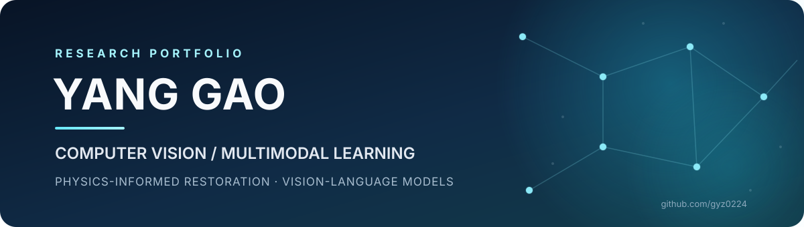

  

# Hi, I'm Gao Yang

**M.S. Student in Artificial Intelligence · Henan University**  
**Research Focus:** Computer Vision · Low-Level Vision · Image Restoration

My research focuses on unsupervised image restoration, especially low-light image enhancement and image dehazing. I am interested in combining physical image-formation models with semantic priors to improve restoration quality and robustness.

## Research Interests

- Low-Light Image Enhancement
- Image Dehazing and Unified Image Restoration
- Physics-Informed Learning: Retinex Theory and Atmospheric Scattering
- Unsupervised and Zero-Reference Learning

## Publication

**Bridging Physical and Semantic Knowledge: A Dual-Prior Driven Unsupervised Network for Low-Light Image Enhancement**

- **Venue:** ACM Multimedia 2026 · Poster
- **Paper:** [ACM Digital Library](https://dl.acm.org/doi/10.1145/3767308.3836197) · [DOI](https://doi.org/10.1145/3767308.3836197)
- **Code:** [SPS-Net](https://github.com/gyz0224/SPS-Net)

## Selected Projects

### [SPS-Net](https://github.com/gyz0224/SPS-Net)
**Unsupervised Low-Light Image Enhancement**

Combines Retinex-based physical priors with pre-trained semantic representations for low-light image enhancement. Accepted at ACM Multimedia 2026.

### [Zero-Multi](https://github.com/gyz0224/Zero-Multi)
**Zero-Reference Multi-Prior Low-Light Image Enhancement**

Explores depth, semantic, and luminance priors, with teacher–student distillation to transfer prior knowledge into a lightweight student model.

[Method Overview](https://github.com/gyz0224/Zero-Multi/blob/master/figs/Zero-Multi.pdf)

### [UniSPS](https://github.com/gyz0224/UniSPS)
**Unified Unsupervised Image Restoration**

A unified framework for low-light image enhancement and image dehazing, combining Retinex-based enhancement with atmospheric-scattering-based dehazing under shared semantic guidance.

## Technical Skills

- **Programming:** Python
- **Deep Learning:** PyTorch
- **Computer Vision:** OpenCV, image restoration and enhancement
- **Tools:** Linux, Git, CUDA, LaTeX

## Links

- [GitHub Repositories](https://github.com/gyz0224?tab=repositories)
- [ACM MM 2026 Paper](https://doi.org/10.1145/3767308.3836197)
